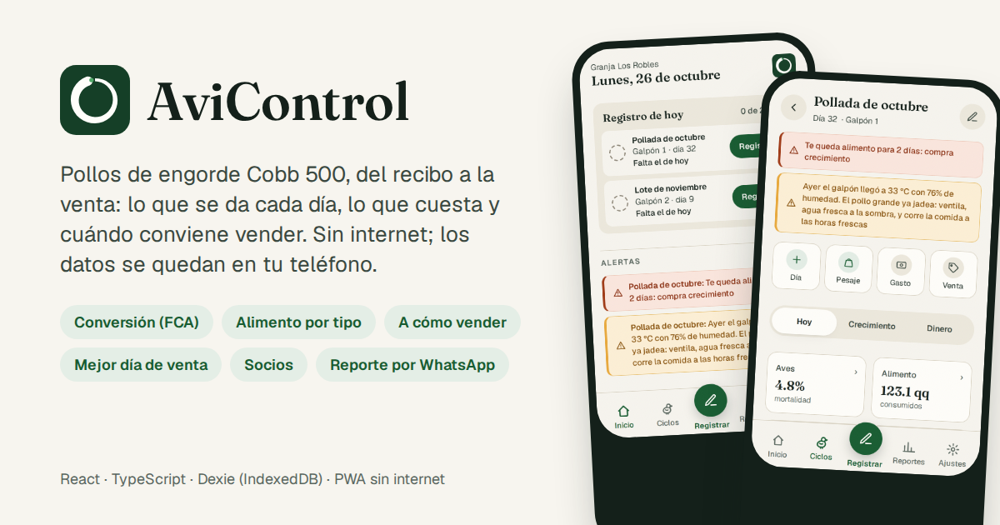

# AviControl

> **PWA de gestión de pollos de engorde Cobb 500**, organizada alrededor del ciclo: registro diario en segundos, guía del día contra el estándar de la línea, muestreo de peso, precio mínimo de venta y control de sociedad. **Local-first**: todos los datos viven en el teléfono y funciona sin internet.


[](https://github.com/AngelixVrobles/AviControl/actions/workflows/ci.yml)




**Demo en vivo:** https://avi-control.vercel.app — ábrela en el teléfono y usa *Añadir a pantalla de inicio* para instalarla como app.

---

## Qué es

App para engordadores que llevan el control de sus camadas en papel o en la cabeza. Toda la app gira alrededor del **ciclo de engorde** (~41 días) y de la única decisión que importa: **cuándo vender y a qué costo por libra**. Cada ciclo registra su día a día — mortalidad, alimento, peso — y la app calcula sola los números del negocio: conversión alimenticia, costo por libra, margen y ganancia. Pesos y alimento en **libras**, como se vende el pollo en República Dominicana.

Está especializada en **Cobb 500**: las curvas de peso, consumo y conversión son la tabla *as-hatched* del [Cobb500 Broiler Performance & Nutrition Supplement (2022)](https://www.cobbgenetics.com/assets/Cobb-Files/2022-Cobb500-Broiler-Performance-Nutrition-Supplement.pdf), día por día del 0 al 56.

Sin cuentas, sin servidor, sin internet: los datos se guardan en el dispositivo (IndexedDB) y se respaldan en un archivo `.json` que en el teléfono sale por el menú de compartir —Archivos, WhatsApp, Drive—. Hasta las letras van dentro de la app: abre igual sin señal desde la primera vez.

## Lo que hace

- **Registrar el día en segundos:** mortalidad y descarte con **+** y **−**, de qué murieron, alimento en quintales o en libras con sugerencias según el consumo reciente, y la temperatura y la humedad del galpón, con lo que significan a esa edad.
- **Varios galpones:** cada ciclo en el suyo, y una misma pollada repartida entre galpones cuando ya no caben, con la densidad y el equipo calculados con las medidas de cada uno.
- **Guía del día contra Cobb 500:** peso ideal frente al real, alimento del día y acumulado, conversión esperada, agua, temperatura y mortalidad esperada. La primera semana se juzga aparte: recibo, incubadora y peso al día 7.
- **Pesar bien:** cuántas aves pesar para que el promedio valga para todo el galpón, con el margen de error, la uniformidad y el CV calculados en vivo mientras se pesa.
- **Alimento:** el tipo de cada saco (pre-inicio, iniciador, crecimiento, engorde), para cuántos días alcanza, cuánto falta comprar y a qué precio. Lo que sobra al cerrar pasa al ciclo siguiente con su costo.
- **¿A cuánto y cuándo vender?:** precio mínimo por libra para no perder, escalera de precios por margen, el día en que la ganancia deja de subir y la ganancia estimada con su rango. También dice si conviene más vender el pollo arreglado o en pie.
- **Ventas y cobros:** ventas por cajas como en el cuaderno del pollero, aves que se cuadran solas cuando sale el último pollo, ventas a crédito y lo que debe cada comprador.
- **Sociedad:** gastos y ganancias repartidos por porcentaje, lo que puso y cobró cada socio, quién le entrega cuánto a quién, y el ciclo enviado al socio como copia de solo lectura.
- **Alertas y sanidad:** días sin registrar o sin pesar, mortalidad alta, conversión desviada del estándar, calor, cambios de fase, las vacunas del plan sanitario y los días de retiro de cada medicina antes de la venta.
- **Reportes y respaldo:** comparación entre camadas, incubadoras y galpones, imagen para WhatsApp, Excel y PDF del ciclo, y respaldo `.json` que se revisa antes de restaurar.

El detalle de cada función está en **[la lista completa](docs/funcionalidades.md)**.

## Lo técnicamente interesante

- **Estimado de peso con un filtro de Kalman:** sigue qué fracción del peso Cobb lleva el lote, en escala logarítmica, con todos los pesajes y no solo el último. A cada pesaje le da peso según cuántas aves se pesaron y qué tan parejas estaban, aprende de lo que lograron las polladas cerradas de la granja y entrega el peso al vender y la ganancia con su rango (8 de cada 10 veces).
- **La báscula de la granja contra la del pollero:** el mismo filtro estima a la vez el peso del lote y cuánto se aparta la báscula de la granja de la del comprador, aprendido de las ventas cerradas y acercado a cero mientras hay pocos datos.
- **Muestreo estadístico:** tamaño de muestra, intervalo de confianza del 95 % con corrección por población finita, CV y uniformidad.
- **El mejor día de venta, al margen:** compara día por día el costo de la libra marginal con el precio de venta, porque cada día extra el pollo convierte peor.
- **Local-first reactivo:** IndexedDB con Dexie y *live queries*; cada escritura vuelve a pintar solo las vistas afectadas, sin backend, y los respaldos viejos se migran solos.
- **Archivos hechos en el teléfono:** el `.xlsx` se escribe sin librerías y el reporte se dibuja en Canvas 2D y se comparte con la Web Share API.
- **Calidad:** pruebas con Vitest, pruebas de pantalla con Playwright en el tamaño de un iPhone y CI en cada PR.

## Arquitectura

SPA local-first sin backend. La capa de datos es reactiva: cualquier escritura en IndexedDB re-renderiza las vistas afectadas.

```
src/
  db/          Esquema Dexie (lotes, registros, pesajes, gastos, ingresos,
               aplicaciones, entregas, deudas, abonos y la copia de antes de
               restaurar), borrar un ciclo y armar el respaldo
  lib/         Lógica de dominio: métricas, curva Cobb 500, plan de alimento,
               muestreo estadístico, equipo y galpones, alertas, calor, retiro,
               primera semana, proyección de venta, precios y punto óptimo,
               cobros, sociedad, reporte en canvas, Excel (.xlsx propio), ciclo
               compartido, revisión de archivos, formato es-DO
  components/  UI reutilizable: las hojas para anotar (hojas/), cards,
               gráficos, comparación
  screens/     Inicio, Ciclos, Detalle con sus pestañas (ciclo/) y sus fichas,
               Nuevo ciclo, Reportes, Te deben, Deudas, Ajustes, Imprimir
e2e/           Pruebas de pantalla con Playwright
```

**Flujo de datos:** `IndexedDB (Dexie)` → `useLiveQuery` → `métricas puras` → `UI (React)`.

**Carga:** Inicio y Ciclos van en el paquete de entrada; las demás pantallas se bajan al abrirse y las librerías van aparte, para que una actualización de la app no las vuelva a bajar. Con la app instalada todo queda guardado en el teléfono.

## Stack tecnológico

| Capa | Tecnologías |
|------|-------------|
| UI | React 19, Tailwind CSS, animaciones en CSS, gráficas propias en SVG |
| Datos | Dexie sobre IndexedDB, live queries reactivas |
| Offline / PWA | vite-plugin-pwa (Workbox), letras incluidas en la app (Fontsource) |
| Lenguaje / build | TypeScript, Vite |
| Reporte | Canvas 2D nativo + Web Share API, `.xlsx` propio, hoja para imprimir |
| Calidad | Vitest, Playwright (pruebas de pantalla), oxlint, GitHub Actions en cada PR |
| Despliegue | Vercel |

## Cómo ejecutar

```bash
# Requisitos: Node 22 (o 20.19+)
npm install
npm run dev       # desarrollo en http://localhost:5173
npm test          # pruebas
npm run test:e2e  # pruebas de pantalla (Playwright, en el tamaño de un iPhone)
npm run lint      # lint
npm run build     # tipos y build de producción en dist/
```

Cada PR corre lo mismo en GitHub Actions: lint, pruebas, build y las pruebas de pantalla.

## Instalar en el teléfono

1. Abre la URL en Safari (iPhone) o Chrome (Android).
2. **Compartir → Añadir a pantalla de inicio** (iOS) o **Instalar** (Android). Inicio lo ofrece hasta que se instala: en Android con un botón, en el iPhone con los pasos.
3. Se abre desde su ícono, a pantalla completa y sin conexión.

En el iPhone conviene instalarla: Safari puede borrar los datos de una página que no se abre en siete días, y la app instalada guarda los suyos aparte. Como empieza vacía, quien ya tenía datos en Safari hace un respaldo allí y lo restaura en la app.

## Licencia

© 2026 AngelixVrobles. **Uso gratuito**: cualquiera puede instalarla y usarla sin pagar; no se permite venderla ni copiar, modificar o publicar el código sin permiso por escrito. Texto completo en [`LICENSE`](LICENSE).

---

**Angelix Vásquez R.** · [GitHub](https://github.com/AngelixVrobles)
