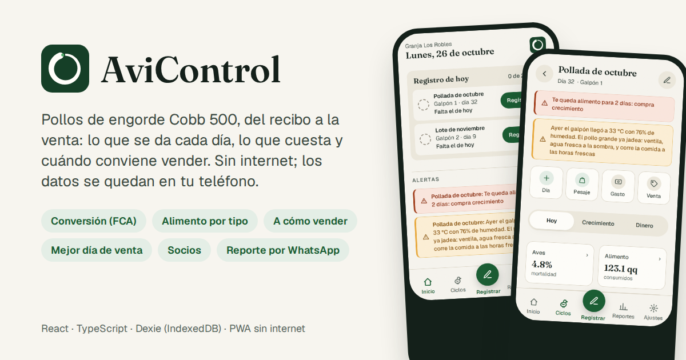

# AviControl

> **PWA de gestión de pollos de engorde Cobb 500**, organizada alrededor del ciclo: registro diario en segundos, guía del día contra el estándar de la línea, muestreo de peso, precio mínimo de venta y control de sociedad. **Local-first**: todos los datos viven en el teléfono y funciona sin internet.




**Demo en vivo:** https://avi-control.vercel.app — ábrela en el teléfono y usa *Añadir a pantalla de inicio* para instalarla como app.

---

## Qué es

App para engordadores que llevan el control de sus camadas en papel o en la cabeza. Toda la app gira alrededor del **ciclo de engorde** (~41 días) y de la única decisión que importa: **cuándo vender y a qué costo por libra**. Cada ciclo registra su día a día — mortalidad, alimento, peso — y la app calcula sola los números del negocio: conversión alimenticia, costo por libra, margen y ganancia. Pesos y alimento en **libras**, como se vende el pollo en República Dominicana.

Está especializada en **Cobb 500**: las curvas de peso, consumo y conversión son la tabla *as-hatched* del [Cobb500 Broiler Performance & Nutrition Supplement (2022)](https://www.cobbgenetics.com/assets/Cobb-Files/2022-Cobb500-Broiler-Performance-Nutrition-Supplement.pdf), día por día del 0 al 56.

Sin cuentas, sin servidor, sin internet: los datos se guardan en el dispositivo (IndexedDB) y se respaldan en un archivo `.json` que en el teléfono sale por el menú de compartir —Archivos, WhatsApp, Drive—. Hasta las letras van dentro de la app: abre igual sin señal desde la primera vez.

## Funcionalidades

- **Varios galpones**: cada uno con su nombre y sus medidas, y cada ciclo en el suyo —al crearlo propone el que no tiene un ciclo en curso—, con la densidad, el recibo y el equipo calculados con las medidas de ese galpón.
- **Una pollada en varios galpones**: cuando de grandes ya no caben, parte de las aves se pasa a otro galpón y sigue siendo el mismo ciclo. Se anota la fecha, de cuál salen, a cuál van y cuántas —el otro galpón se crea ahí mismo si no estaba—, o se reparte desde el día que llegan. La ficha Galpón dice cuántas hay en cada uno y cuántas aguanta al peso de venta; las bajas se reparten según las aves de cada galpón, y la venta dice de cuál salieron. Un aviso dice cuándo un galpón no aguanta sus aves, y cuántas pasar, y no deja pasar más aves de las que había ese día. Inicio dice en qué galpones hay aves hoy, y un galpón que se quita de Ajustes no le borra el nombre a los ciclos que estuvieron en él.
- **Ciclos de engorde** con barra de progreso e hitos (recibo, vacunas, cambios de alimento, retiro y venta), sobre la curva Cobb 500 escalada al rendimiento real del lote. Con el lápiz del ciclo se corrige lo que se anotó al crearlo —fecha, pollitos, lo que costaron, peso y precio de venta, socios— sin romper lo ya registrado, o se borra el ciclo con todo lo suyo. Cada ciclo nuevo trae el peso y el **día de venta** de Ajustes, y el que no tiene los suyos los sigue.
- **Inicio**: el registro de hoy de cada ciclo, las alertas y el **precio mínimo para no perder** de todos los ciclos juntos —sus costos entre sus libras, para que cada galpón pese lo que produce—, contra el precio de mercado, y la ganancia estimada al vender a tu precio. Si pasa una semana sin respaldo, lo recuerda y deja respaldar ahí mismo.
- **Registro diario en segundos**: mortalidad y descarte que se escriben o se cuentan con **+** y **−**, y de qué murió la mayoría —calor, amontonadas, enfermedad, muerte súbita, ascitis—, que la ficha Aves junta para decir de qué se muere el lote; alimento **en quintales (qq) o en libras** con chips sugeridos según tu consumo reciente, y el alimento que se dio —el que toca por las compras, que se cambia con un toque—, peso opcional y la **temperatura máxima y la humedad** del galpón, que dicen al momento qué significan a esa edad. Un pesaje no cuenta como el registro del día hasta que se completan las bajas y el alimento. Un toque guarda una vez, y las fechas se quedan dentro del ciclo.
- **El recibo y la primera semana**: incubadora, peso de los pollitos al llegar y muertos en las cajas. La primera semana se juzga contra lo normal —muertos en las cajas hasta 0.5 %, bajas hasta 1 %, y al día 7 pesar 4.5 veces lo que pesaron al llegar— y Reportes compara las incubadoras entre ciclos.
- **Calor**: avisa el calor de hoy o de ayer según la edad —desde el día 21, 30 °C ya es calor y 34 °C es peligro, o °F más % de humedad sobre 160 y 170—, el frío de los pollitos, y compara lo que murió los días de calor contra los demás.
- **Muestreo de peso**: dice cuántas aves pesar para que el promedio valga para todo el galpón, y al ir pesando calcula en vivo el promedio, el **margen de error** (IC 95 % con corrección por población finita), la **uniformidad** y el **CV**, el % del estándar Cobb y las libras vivas del galpón. La casilla y el **+** se quedan fijos arriba aunque la lista crezca, cada peso se guarda en el teléfono al momento (si la hoja se cierra, al abrirla siguen ahí), se deshace el último con un toque y se marcan en rojo los pesos que parecen un error al escribir.
- **Guía del día**: peso ideal para la edad vs. el real, alimento del día y acumulado, FCA esperado, agua, temperatura de galpón, densidad y mortalidad esperada.
- **Alimento por tipo**: cada compra lleva el nombre del saco —«Mega Broiler Crecimiento», «19 quintales de engorde»— y la app saca de ahí si es **pre-inicio, iniciador, crecimiento o engorde**; si el nombre no lo dice, se toca cuál es. Los sacos se dan en orden —se acaba uno y sigue el próximo, sin volver atrás—, y lo que el productor elige en el registro del día manda. Con eso Hoy dice qué alimento se está dando, para cuántos días alcanza y cuál sigue; un aviso dice cuándo se acaba el de ahora y el próximo no está comprado; y la ficha de Alimento lo junta por tipo: lo comprado, lo dado, lo que queda, en qué días se dio y cuánto falta comprar de cada uno. Lo que falta se paga **al precio de su tipo** —lo último que se pagó por él en el ciclo o en la granja—, no al promedio con el pre-inicio caro.
- **Plan de alimento en cuatro fases**: sin compras anotadas, Hoy dice la fase que toca por la edad, con su proteína y presentación, y avisa el día de cambio; con compras, la ficha compara lo dado de cada tipo contra lo que come un lote Cobb esos mismos días.
- **Existencia de alimento**: anotando los quintales de cada compra, la app lleva el saldo del galpón, calcula **hasta qué día alcanza** con el consumo real del lote, avisa cuando quedan tres días o menos, y usa el **precio real del quintal** — promedio ponderado de lo que pagaste — para costear el plan, la proyección y el precio de equilibrio. Lo que sobró al cerrar **pasa al ciclo que sigue con su costo**: el que cierra deja de cargar con sacos que no se comió y el siguiente los tiene en su almacén. No se pasa más de lo que hay, y entre ciclos con socios distintos se dice quién lo pone y quién se lo queda.
- **Conteo de sacos**: para quien no pesa el alimento cada día. Cuentas los sacos que quedan en el almacén y la app saca lo que se dio (lo comprado menos lo que queda); lo que no se anotó día por día se reparte con la curva de consumo Cobb. Con eso salen el consumo por fase y la **conversión**, que se mide al último día con dato de alimento. Sin alimento la conversión no se inventa: la ficha dice qué falta y cómo llenarlo.
- **Detalle en pestañas** (Hoy / Crecimiento / Dinero) con la curva de peso vs. estándar, índice de eficiencia (EPEF) y resumen semanal.
- **«¿A cómo vender?»**: precio mínimo por libra para no perder, cuánto de cada libra es alimento / pollito / lo demás, y la escalera de precios por margen (10 %, 15 %, 20 %, 25 %) con tu precio marcado en su lugar.
- **«¿Hasta qué día conviene?»**: el día en que la ganancia deja de subir, con la curva día por día y el **costo de la libra marginal** contra el precio de venta — porque cada día extra el pollo convierte peor y llega un punto en que engordarlo cuesta más de lo que se cobra por él. Cada día se paga el alimento que toca ese día, y si elegiste un día de venta, dice cuánto va de ese al mejor.
- **Comederos y bebederos**: cuántos hacen falta para las aves que hay con el equipo de tu granja — **bebederos Plasson** o niples, **comederos de tolva** o platos —, con la cifra de aves por equipo editable si tu modelo es otro; lo del recibo (bandejas, bebederos de galón y criadoras) y el agua que beben al final del ciclo para dimensionar el tanque. Con las medidas del galpón, en **metros o pies**: cuántas aves caben (la densidad de la granja sin pasar de 30 kg/m² al peso de venta), dónde cerrar el recibo, en cuántas líneas se reparte el equipo y cada cuánto va cada uno. Al crear un ciclo dice qué hace falta para esa cantidad de pollitos. Cifras de Plasson y de la Guía de Manejo de Cobb.
- **«Si vendes…»**: compara la ganancia de vender hoy, al peso objetivo (recomendado) o más tarde, con la advertencia cuando las aves comen más de lo que crecen.
- **Proyección de venta financiera**: fecha estimada al peso objetivo, mortalidad que falta por ocurrir, alimento restante en quintales —separando lo que ya está pagado en el almacén de lo que falta comprar, para no cobrar dos veces lo comprado por adelantado—, costo e ingreso proyectados y **precio de equilibrio** por libra.
- **Día de venta**: cada quien vende a su edad —a los 35 días, a los 42, cuando el comprador los pide—. Se elige un día fijo o vender cuando lleguen al peso de venta, en el ciclo o para todos en Ajustes, y hasta ese día se cuentan el alimento que falta, el pago de los empleados y la ganancia estimada.
- **Ganancia estimada**: lo que queda al vender a tu precio, renglón por renglón —lo ya vendido y lo que falta por vender, lo gastado, el **alimento por comprar**, lo que falta del **pago de los empleados** (por día, semana, quincena, mes, por la pollada o por pollo, menos lo ya anotado como mano de obra) y los **gastos que vienen** (la luz, el transporte…), que con «Ya lo pagué» pasan a los gastos—. Todo eso entra también en el precio mínimo, en la parte de cada socio y en el mejor día para vender, que cuenta el sueldo de cada día de más.
- **Pollo arreglado**: quien vende el pollo matado y limpio lo dice en Ajustes; las cuentas van entonces por **libra arreglada**, con el **rinde** —lo que queda de cada 100 lb en pie, que la app también saca de los pesajes y de lo que pesaron las ventas— y lo que cuesta arreglar cada pollo. Dice si a tu precio conviene más arreglarlo o venderlo en pie al pollero, y desde qué precio por libra arreglada deja de convenir. El peso por ave y la conversión siguen en pie.
- **Sociedad**: reparte gastos y ganancias entre socios con % configurables y lleva la cuenta de cada uno: lo que puso, lo que cobró de las ventas y **su ganancia individual** (estimada antes de vender, real después). Dice quién le entrega cuánto a quién —mientras el ciclo sigue, para seguir mitad y mitad con los gastos, sin contar el dinero de las ventas, que lo guarda quien lo cobró y se reparte al cerrar; al cerrar, para que cada uno recupere lo suyo y su parte de la ganancia— y las **entregas entre socios** se anotan, también por partes, para que la cuenta quede al día en vez de pedir el mismo pago para siempre. La cuenta se comparte por WhatsApp.
- **Alertas** con tope y prioridad por severidad: días sin registrar, días sin pesar, mortalidad alta, FCA desviado del estándar Cobb —juzgado al día en que se midió, y sin dar por buena una conversión imposible—, calor, cambios de fase de alimento, las vacunas de **tu plan sanitario** —la víspera, el día y unos días si se pasan sin anotar; lo ya aplicado no avisa— y el **retiro de cada medicina**: con los días que se da y los días de retiro del frasco, avisa si la venta cae antes de que se cumpla, y la hoja de venta lo dice antes de guardar. También el galpón que no aguanta sus aves al peso de venta. Las cuentas del día se rehacen solas a medianoche aunque la app siga abierta.
- **Venta**: el total sale del peso por el **precio por libra**, o se escribe a mano si el comprador redondeó. Al pollero se le vende **por cajas**, como en el cuaderno: sus cajas vacías se pesan por grupos —6 cajas, 94 lb—, después llenas las veces que haga falta, y la app resta y saca las libras de pollo. Las aves salen de las cajas —10 por caja, o lo que diga el pollero— y, si el lote tiene un pesaje, también del peso, aunque nadie las cuente: si las dos cuentas no cuadran, avisa de que sobrecargaron las cajas y se elige con cuál quedarse. Recuerda cuánto pesan las cajas de cada pollero y cuántos pollos les mete. Cada venta dice si salió en pie o arreglada, y **cada comprador trae su precio**: al escribir su nombre sale el de la última vez, y los precios que usas se tocan en vez de escribirlos. Si una venta se lleva las últimas aves, el ciclo se cierra con ella y guarda lo que la app proyectaba para compararlo con lo que pasó. Se vende de contado o **a crédito**, con lo que dio al llevarse el pollo y los cobros que van llegando; **«Te deben»** junta, en Inicio y en su pantalla, lo que debe cada comprador y desde cuándo, y desde ahí se **corrige la venta**: al cambiarle el precio, lo que falta se saca otra vez con lo que ya dio. Lo cobrado es lo que se reparte entre los socios al cerrar el ciclo.
- **Inversión por día**: cuánto llevabas invertido a los 10, 20, 30 o 40 días (o el día que elijas), con el desglose por categoría —alimento, pollitos, medicinas, cama, gas y luz, mano de obra…— y la comparación por pollito contra tus otros ciclos a la misma edad, día a día en una gráfica.
- **Comparación entre camadas** —con el peso real de venta de cada ciclo cerrado—, **por incubadora** y **por galpón**, y **reporte compartible** en imagen para WhatsApp: la granja primero, la ganancia (o, en curso, la estimada al vender) en grande y los números del ciclo con letra que se lee en el teléfono. Lo que no se ha vendido no sale como pérdida.
- **Excel y PDF**: el ciclo en un `.xlsx` —resumen, días, gastos, ventas, pesajes, sanidad y entregas, con fechas y montos como tales— armado en el teléfono sin librerías, y un reporte en hoja limpia para imprimir o guardar en PDF, que en un ciclo en curso dice lo invertido y la ganancia estimada al vender. El Excel dice el tipo de alimento de cada día y de cada compra.
- **Mandar el ciclo al socio**: un archivo con todo el ciclo que el socio abre en su AviControl como una copia de solo mirar; no entra en las cuentas de su granja, y cuando se lo mandas otra vez se pone al día.
- **Lo nuevo de cada versión**: después de actualizar, Inicio lo cuenta una vez; en Ajustes se vuelve a ver.
- **Respaldo**: exportar/importar todos los datos en `.json`, con migración automática de respaldos antiguos. Antes de restaurar, cada fila se revisa: un archivo dañado no cambia nada y dice qué tiene. Se dice de cuándo es el respaldo, con el año, y lo que había se guarda: si no era ese, **«Volver a eso»** en Ajustes lo trae de vuelta. En el teléfono el archivo sale por el menú de compartir —en Android como `.txt`, que sí se comparte por WhatsApp o Drive y se restaura igual— y el último respaldo solo se anota si el archivo salió del teléfono. La app le pide al navegador que no borre sus datos cuando le falte espacio.
- **Atrás y versiones nuevas**: en Android, el botón Atrás cierra la hoja abierta en vez de salir de la pantalla. Cuando hay una versión nueva, un aviso la pone con un toque —antes llegaba tarde y sin avisar—; la app pregunta cada vez que se vuelve a ella, y Ajustes busca una al momento.

## Arquitectura

SPA local-first sin backend. La capa de datos es reactiva: cualquier escritura en IndexedDB re-renderiza las vistas afectadas.

```
src/
  db/          Esquema Dexie (lotes, registros, pesajes, gastos, ingresos,
               aplicaciones, entregas, deudas, abonos y la copia de antes de
               restaurar), borrar un ciclo y armar el respaldo
  lib/         Lógica de dominio: métricas, curva Cobb 500, plan de alimento,
               muestreo estadístico, equipo y galpones, alertas, calor, retiro,
               primera semana, proyección de venta, precios y punto óptimo,
               cobros, sociedad, reporte en canvas, Excel (.xlsx propio), ciclo
               compartido, revisión de archivos, formato es-DO
  components/  UI reutilizable: las hojas para anotar (hojas/), cards,
               gráficos, comparación
  screens/     Inicio, Ciclos, Detalle con sus pestañas (ciclo/) y sus fichas,
               Nuevo ciclo, Reportes, Te deben, Deudas, Ajustes, Imprimir
e2e/           Pruebas de pantalla con Playwright
```

**Flujo de datos:** `IndexedDB (Dexie)` → `useLiveQuery` → `métricas puras` → `UI (React)`.

**Carga:** Inicio y Ciclos van en el paquete de entrada; las demás pantallas se bajan al abrirse y las librerías van aparte, para que una actualización de la app no las vuelva a bajar. Con la app instalada todo queda guardado en el teléfono.

## Stack tecnológico

| Capa | Tecnologías |
|------|-------------|
| UI | React 19, Tailwind CSS, animaciones en CSS, gráficas propias en SVG |
| Datos | Dexie sobre IndexedDB, live queries reactivas |
| Offline / PWA | vite-plugin-pwa (Workbox), letras incluidas en la app (Fontsource) |
| Lenguaje / build | TypeScript, Vite |
| Reporte | Canvas 2D nativo + Web Share API, `.xlsx` propio, hoja para imprimir |
| Calidad | Vitest, Playwright (pruebas de pantalla), oxlint, GitHub Actions en cada PR |
| Despliegue | Vercel |

## Cómo ejecutar

```bash
# Requisitos: Node 22 (o 20.19+)
npm install
npm run dev       # desarrollo en http://localhost:5173
npm test          # pruebas
npm run test:e2e  # pruebas de pantalla (Playwright, en el tamaño de un iPhone)
npm run lint      # lint
npm run build     # tipos y build de producción en dist/
```

Cada PR corre lo mismo en GitHub Actions: lint, pruebas, build y las pruebas de pantalla.

## Instalar en el teléfono

1. Abre la URL en Safari (iPhone) o Chrome (Android).
2. **Compartir → Añadir a pantalla de inicio** (iOS) o **Instalar** (Android). Inicio lo ofrece hasta que se instala: en Android con un botón, en el iPhone con los pasos.
3. Se abre desde su ícono, a pantalla completa y sin conexión.

En el iPhone conviene instalarla: Safari puede borrar los datos de una página que no se abre en siete días, y la app instalada guarda los suyos aparte. Como empieza vacía, quien ya tenía datos en Safari hace un respaldo allí y lo restaura en la app.
